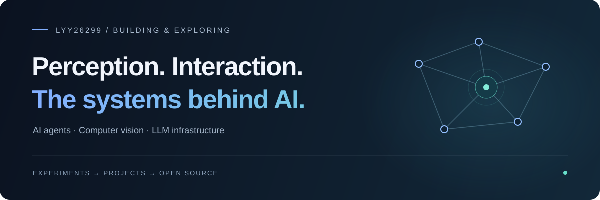

  

  <a href="#open-source">Open source</a> &nbsp; / &nbsp;
  <a href="#selected-projects">Selected projects</a> &nbsp; / &nbsp;
  <a href="#toolbox">Toolbox</a>

 

I explore **AI agents, computer vision, and LLM infrastructure** — from experiments in motion and voice interaction to contributions to open source systems.

探索 AI 如何感知、交互与运行。做运动与视觉相关的 Agent 项目，也参与 LLM 开源基础设施开发。

 

## Open source

### [vLLM Semantic Router](https://github.com/vllm-project/semantic-router)

Contributing to the systems behind LLM routing.

**[MCP client lifecycle · #4505 ↗](https://github.com/vllm-project/semantic-router/pull/4505)** &nbsp; `Merged`

修复 Dashboard 关闭时 MCP 连接与子进程的清理问题，覆盖延迟连接、初始化中的连接与并发关闭，并补充回归测试和 Go race 测试。

Go &nbsp; / &nbsp; MCP &nbsp; / &nbsp; Concurrency &nbsp; / &nbsp; Resource lifecycle

 

**[Chinese documentation locale · #4478 ↗](https://github.com/vllm-project/semantic-router/pull/4478)**

规范简体中文文档的 locale 基础 URL，让文档路径保持一致。

[Explore my contributions →](https://github.com/vllm-project/semantic-router/pulls?q=is%3Apr+author%3Alyy26299)

 

## Selected projects

<table>
  <tr>
    <td width="50%" valign="top">
      01 / VISION &amp; INTERACTION
      <h3><a href="https://github.com/lyy26299/vision-agent-real-demo_v2.0">Vision Agent ↗</a></h3>
      
结合姿态识别与语音反馈的实时 AI 健身教练。

      
Computer vision · Pose recognition · Voice feedback

    </td>
    <td width="50%" valign="top">
      02 / REALTIME MOTION
      <h3><a href="https://github.com/lyy26299/motion-relay">Motion Relay ↗</a></h3>
      
基于 Vision-Agents 的实时运动交互项目，结合姿态感知与 AI 语音指导。

      
Python · Vision-Agents · Realtime interaction

    </td>
  </tr>
  <tr>
    <td colspan="2" valign="top">
      03 / EVERYDAY TOOLS
      <h3><a href="https://github.com/lyy26299/txt2epubforkindle">TXT → EPUB ↗</a></h3>
      
将 TXT 转换为适合 Kindle 阅读的 EPUB，支持章节划分。

      
Python · EPUB · Reading workflow

    </td>
  </tr>
</table>

 

## Toolbox

| Area | Technologies used |
| :--- | :--- |
| Languages | Go · Python · JavaScript |
| AI & vision | YOLO · Gemini |
| Systems & integration | MCP · LLM routing |

 

---

  lyy26299 &nbsp; · &nbsp; Explore ideas. Build projects. Contribute back.

