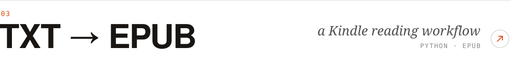
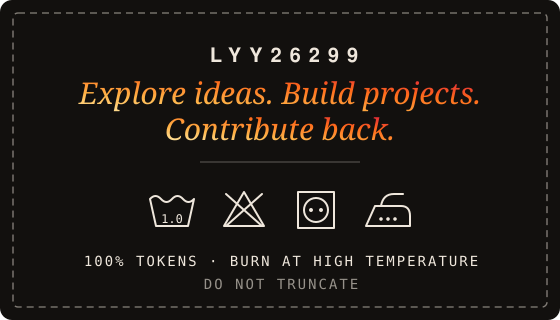

  

  I explore <b>AI agents, computer vision, and LLM infrastructure</b> — from experiments in motion and voice interaction to contributions to open source systems. 
  探索 AI 如何感知、交互与运行。做运动与视觉相关的 Agent 项目，也参与 LLM 开源基础设施开发。

 

  <picture>
    <source media="(prefers-color-scheme: dark)" srcset="assets/label-open-source-dark.svg">
    
  </picture>

  <a href="https://github.com/vllm-project/semantic-router">
    <picture>
      <source media="(prefers-color-scheme: dark)" srcset="assets/work-semantic-router-dark.svg">
      
    </picture>
  </a>

  <a href="https://github.com/vllm-project/semantic-router/pull/4505"><b>MCP client lifecycle · #4505 ↗</b></a> &nbsp; <code>Merged</code> 
  修复 Dashboard 关闭时 MCP 连接与子进程的清理问题，覆盖延迟连接、初始化中的连接与并发关闭，并补充回归测试和 Go race 测试。

  <a href="https://github.com/vllm-project/semantic-router/pull/4478"><b>Chinese documentation locale · #4478 ↗</b></a> 
  规范简体中文文档的 locale 基础 URL，让文档路径保持一致。

<a href="https://github.com/vllm-project/semantic-router/pulls?q=is%3Apr+author%3Alyy26299">Explore my contributions →</a>

 

  <picture>
    <source media="(prefers-color-scheme: dark)" srcset="assets/label-work-dark.svg">
    
  </picture>

  <a href="https://github.com/lyy26299/vision-agent-real-demo_v2.0">
    <picture>
      <source media="(prefers-color-scheme: dark)" srcset="assets/work-vision-agent-dark.svg">
      
    </picture>
  </a>

结合姿态识别与语音反馈的实时 AI 健身教练。

  <a href="https://github.com/lyy26299/motion-relay">
    <picture>
      <source media="(prefers-color-scheme: dark)" srcset="assets/work-motion-relay-dark.svg">
      
    </picture>
  </a>

基于 Vision-Agents 的实时运动交互项目，结合姿态感知与 AI 语音指导。

  <a href="https://github.com/lyy26299/txt2epubforkindle">
    <picture>
      <source media="(prefers-color-scheme: dark)" srcset="assets/work-txt-epub-dark.svg">
      
    </picture>
  </a>

将 TXT 转换为适合 Kindle 阅读的 EPUB，支持章节划分。

 

  <picture>
    <source media="(prefers-color-scheme: dark)" srcset="assets/marquee-dark.svg">
    
  </picture>

 

  <picture>
    <source media="(prefers-color-scheme: dark)" srcset="assets/care-label-dark.svg">
    
  </picture>

